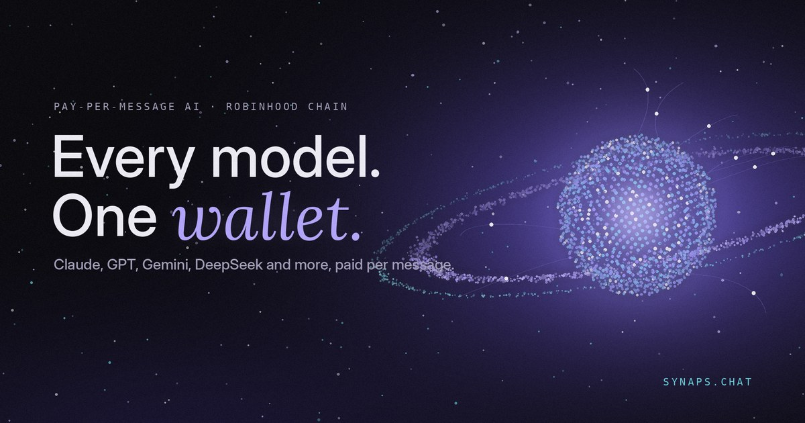
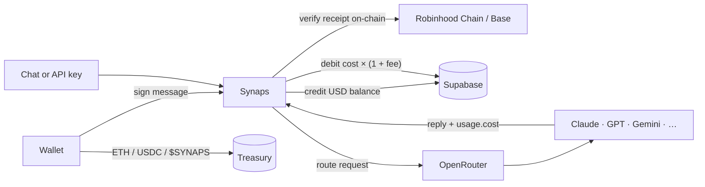

<div align="center">



<h1>Synaps</h1>

<p><strong>Every frontier model. One balance.</strong><br/>
Chat and an OpenAI-compatible API for Claude, GPT, Gemini, Grok, DeepSeek, Qwen and more.<br/>
Pay per message with ETH or USDC on Robinhood Chain and Base. No subscription, no card.</p>

<p>
  <a href="https://www.synaps.chat"></a>
  <a href="https://www.synaps.chat/docs"></a>
  <a href="https://x.com/onsynaps"></a>
  
  
</p>

<p>
  <a href="https://www.synaps.chat/app"><strong>Open the app</strong></a> ·
  <a href="https://www.synaps.chat/models">Models &amp; prices</a> ·
  <a href="https://www.synaps.chat/docs/quickstart">API quickstart</a> ·
  <a href="https://x.com/onsynaps">X</a>
</p>

</div>

---

## Why Synaps

Most AI apps ask for a monthly subscription to one company's models. Synaps works the other way round:

- **Every major model in one place.** Switch between Claude, GPT, Gemini, Grok, DeepSeek, Qwen, Kimi, GLM, Mistral, Llama and image models mid-conversation.
- **Pay only for what you use.** Top up from $1 and each message is deducted at the provider's price plus a flat, visible fee. Prices are shown before you send.
- **Wallet, not account.** Sign in by signing a message with your wallet. No email, no password, no card.
- **One key for builders.** The same balance powers an OpenAI-compatible API, so any OpenAI SDK works by changing the base URL.
- **Clear privacy labels.** Every model shows who can read your prompts: *Free*, *No training*, or *Provider can read*.

## Features

| | |
|---|---|
| 💬 **Chat** | Streaming replies with Markdown and code blocks, model name and cost on every reply, synced history per wallet |
| 🌐 **Web search** | One toggle; the model reads live results and cites numbered sources |
| 📎 **Attachments** | Photos, PDFs and text/code files, with a capability check and a one-tap switch to a model that can handle them |
| 🎨 **Image generation** | Image mode for models that create pictures, with download |
| 🧭 **Custom instructions** | Default language, tone and context applied to every reply, synced across devices |
| 🔗 **Share links** | Read-only public snapshot of a chat, with Stop sharing |
| 🔑 **API keys** | OpenAI-compatible `/api/v1`, per-key daily spend limits, streaming, tool calling, JSON mode |
| 💸 **Top-ups** | ETH on Robinhood Chain or Base, USDC on Base, verified on-chain and credited once per transaction |
| 🎁 **Referrals** | Invite link on the Wallet page; both sides get bonus credit on the friend's first top-up |
| 🪙 **$SYNAPS ready** | The token is detected automatically when the treasury launches it on Pons, then becomes a top-up option with bonus credit |
| 📱 **Installable** | PWA with offline screen and app shortcuts on Android, iOS and desktop |
| 📊 **Admin dashboard** | OpenRouter credit and runway, treasury balances, revenue and profit, top models, alerts |

## Use the API

Create a key on the [API keys](https://www.synaps.chat/app/keys) page, then point any OpenAI client at Synaps.

```bash
curl https://www.synaps.chat/api/v1/chat/completions \
  -H "Authorization: Bearer $SYNAPS_API_KEY" \
  -H "Content-Type: application/json" \
  -d '{
    "model": "anthropic/claude-sonnet-5.5",
    "messages": [{ "role": "user", "content": "Hello!" }]
  }'
```

```python
from openai import OpenAI

client = OpenAI(base_url="https://www.synaps.chat/api/v1", api_key="syn_...")

reply = client.chat.completions.create(
    model="anthropic/claude-sonnet-5.5",
    messages=[{"role": "user", "content": "Hello!"}],
)
print(reply.choices[0].message.content)
```

```ts
import OpenAI from "openai";

const client = new OpenAI({ baseURL: "https://www.synaps.chat/api/v1", apiKey: process.env.SYNAPS_API_KEY });

const stream = await client.chat.completions.create({
  model: "google/gemini-3.8-flash",
  messages: [{ role: "user", content: "Write a haiku about block times." }],
  stream: true,
});
for await (const chunk of stream) process.stdout.write(chunk.choices[0]?.delta?.content ?? "");
```

`GET /api/v1/models` lists every model with its live price, context length and input/output modalities. Every response includes `usage.cost`, the amount charged in USD. Full reference: [synaps.chat/docs](https://www.synaps.chat/docs).

## How it works



1. **Sign in.** The wallet signs a one-time nonce (no gas). The server verifies it and sets an HTTP-only session cookie.
2. **Top up.** The wallet sends ETH, USDC or $SYNAPS to the treasury. The server reads the receipt on-chain, checks sender, recipient and amount, and credits the USD value once per transaction hash.
3. **Use a model.** Requests are routed through OpenRouter. Paid requests to open-weight models are restricted to providers that do not store or train on prompts.
4. **Pay for it.** After each reply the provider's reported cost × (1 + fee) is debited from the balance, even if the client disconnects mid-stream.

All balances are stored in micro-dollars (USD × 10⁶) and changed only inside database functions, so credits and debits are atomic.

## Tech stack

- **App:** Next.js 15 (App Router), React 19, TypeScript
- **Design:** custom CSS design system, three.js, GSAP ScrollTrigger and Lenis on the landing page, Geist and Instrument Serif
- **Wallets:** Privy for connection, viem for signature checks, receipts, ERC-20 transfers and pool prices
- **Data:** Supabase Postgres, with row-level security on every table and server-only access through a service role
- **Models:** OpenRouter, with fallbacks for free models, PDF parsing and the web-search plugin
- **Hosting:** Vercel, with Web Analytics and the GitHub integration

## Run it yourself

**Requirements:** Node.js 20+, a Supabase project, an OpenRouter key and a Privy app.

```bash
git clone https://github.com/onsynaps/Synaps-.git synaps
cd synaps
npm install
cp .env.example .env.local   # fill in the required values
```

1. Open the Supabase SQL editor and run [`supabase/schema.sql`](supabase/schema.sql). It creates the tables and functions and locks them to the service role.
2. In the Privy dashboard, add `http://localhost:3000` (and your domain) to **Allowed domains**.
3. Start the dev server:

```bash
npm run dev
```

The landing page is at `http://localhost:3000`, the app at `/app`, the docs at `/docs` and the admin dashboard at `/app/admin` (for the wallets in `ADMIN_ADDRESSES`).

### Environment variables

| Variable | Required | Purpose |
|---|:---:|---|
| `OPENROUTER_API_KEY` | ✓ | Routes requests to model providers |
| `SUPABASE_URL` / `SUPABASE_SERVICE_ROLE_KEY` | ✓ | Database (server only) |
| `SESSION_SECRET` | ✓ | Signs session cookies |
| `NEXT_PUBLIC_TREASURY` | ✓ | Wallet that receives top-ups |
| `NEXT_PUBLIC_PRIVY_APP_ID` | ✓ | Wallet connection |
| `NEXT_PUBLIC_SITE_URL` | ✓ | Canonical URL for links, sitemap and the API base |
| `MARKUP` | | Fee on top of provider cost (default `0.2`) |
| `FREE_DAILY_LIMIT` / `FREE_GLOBAL_DAILY_LIMIT` | | Free-model allowance per visitor and in total |
| `WEB_SEARCH_FEE_USD` | | Flat fee per web-search message |
| `REF_*` | | Referral percentages, cap and minimum |
| `SYNAPS_*` | | $SYNAPS bonus and manual token or pool override |
| `ADMIN_ADDRESSES`, `LOW_CREDIT_USD` | | Admin access and the credit alert level |
| `RH_RPC_URL`, `BASE_RPC_URL` | | RPC endpoints (a private RPC is recommended in production) |

See [`.env.example`](.env.example) for every option and its default.

## Project structure

```
app/
  page.tsx               landing page
  app/                   the app: chat, wallet, API keys, models, admin
  api/                   chat, auth, top-ups, keys, chats, share, referral, token, admin
  api/v1/                OpenAI-compatible API (chat/completions, models)
  models/                public, indexable model pages
  docs/                  documentation
  s/[id]/                shared chats
components/              UI: landing, app shell, docs kit, logo, PWA
lib/                     billing relay, models, sessions, chains, pricing, token detection
supabase/schema.sql      database schema and functions
public/                  icons and service worker
```

## Security

- The service-role key and OpenRouter key are used only on the server. The browser never sees them.
- Sessions are HTTP-only cookies created from a verified wallet signature over a single-use nonce.
- API keys are stored as SHA-256 hashes. The full key is shown once, when it is created.
- Top-ups are credited only after the transaction is confirmed on-chain, from the signed-in wallet, to the treasury, and only once per transaction hash.
- $SYNAPS is recognised only if the Pons factory reports it was launched by the treasury wallet, in a transaction the treasury sent itself.
- Prompts sent through the API are never stored. Chat history is stored only for signed-in users with sync on, and never includes file contents or generated images.

Found a vulnerability? Please report it privately by DM to [@onsynaps](https://x.com/onsynaps) rather than opening a public issue.

## Links

- **App:** [synaps.chat/app](https://www.synaps.chat/app)
- **Models & prices:** [synaps.chat/models](https://www.synaps.chat/models)
- **Docs:** [synaps.chat/docs](https://www.synaps.chat/docs)
- **X:** [@onsynaps](https://x.com/onsynaps)

<div align="center">
<sub>© 2026 Synaps · Built on Robinhood Chain · $SYNAPS is a utility token, not an investment. Nothing here is financial advice.</sub>
</div>
